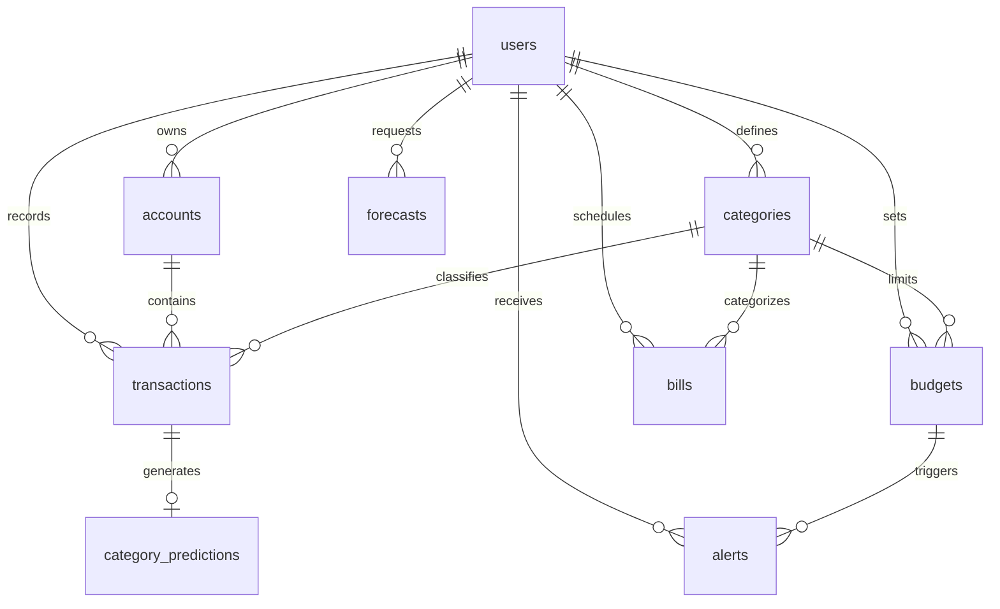

# A MINOR PROJECT REPORT

## ON

# FINTRACK AI: INTELLIGENT PERSONAL FINANCE & EXPENSE PREDICTION SYSTEM

**Submitted in partial fulfillment of the requirements for the award of the degree of**  
**Master of Computer Applications (AI & ML)**

---

### **Submitted By:**

**Himanshu**  
Master of Computer Applications (AI & ML)  
University Institute of Computing (UIC)  
Chandigarh University, Gharuan, Mohali, Punjab

### **Under the Guidance of:**

**Mr. Danish Rashid Pala**  
Assistant Professor  
University Institute of Computing (UIC)  
Chandigarh University

---

<br/>

## CERTIFICATE

This is to certify that **Himanshu**, a student of **Master of Computer Applications (AI & ML)**, Chandigarh University, has successfully completed the Minor Project titled **“FinTrack AI: Intelligent Personal Finance & Expense Prediction System”** under the esteemed guidance of **Mr. Danish Rashid Pala (Assistant Professor)**, University Institute of Computing (UIC), Chandigarh University.

This project has been undertaken as part of the academic curriculum and is submitted in partial fulfillment of the requirements for the award of the degree in **Master of Computer Applications (AI & ML)**. The work presented in this project reflects the student’s independent effort, dedication, and technical competence, demonstrating the ability to apply theoretical concepts of Artificial Intelligence, Machine Learning, and Full-Stack Software Engineering to solve real-world personal finance management problems effectively.

The project, **“FinTrack AI,”** is an intelligent, full-stack personal finance web application designed to empower individuals with comprehensive cash-flow management, automated expense categorization, multi-account reconciliation, and predictive monthly spending forecasts. The system incorporates machine learning models (TF-IDF NLP text classification and time-series rolling horizon forecasting), dynamic budget threshold alerting, interactive Recharts visualizations, and a robust relational database schema with strict user-level data isolation.

I hereby certify that this project is an original work carried out by the student and has not been submitted elsewhere for the award of any other degree, diploma, or certification.

<br/>

**Project Guide:**  
**Mr. Danish Rashid Pala**  
Assistant Professor  
University Institute of Computing (UIC)  
Chandigarh University

---

<br/>

## ACKNOWLEDGEMENT

I would like to express my sincere gratitude to my project guide, **Mr. Danish Rashid Pala**, Assistant Professor, University Institute of Computing (UIC), and respected faculty members for their continuous guidance, constructive feedback, and encouragement throughout the research and development of **FinTrack AI**. Their insights played a critical role in shaping both the machine learning architecture and the software engineering principles applied in this project.

I am also thankful to the **Department / University Institute of Computing** and **Chandigarh University** for providing the academic ecosystem, modern computing resources, and supportive learning environment that enabled the successful completion of this minor project. Undertaking this project has substantially deepened my technical expertise in building production-ready FastAPI backends, asynchronous data pipelines, scikit-learn predictive modeling, and scalable relational database designs.

Finally, I express my heartfelt appreciation to my family and friends for their constant motivation, patience, and support throughout the journey of this academic endeavor.

<br/>

**Himanshu**  
Master of Computer Applications (AI & ML)  
Chandigarh University

---

<br/>

## TABLE OF CONTENTS

| Section | Title                                                        | Page No. |
| :-----: | :----------------------------------------------------------- | :------: |
|    1    | **Abstract**                                                 |    5     |
|    2    | **Introduction**                                             |    6     |
|    3    | **Problem Statement**                                        |    7     |
|    4    | **Objectives**                                               |    8     |
|    5    | **Scope of the Project**                                     |    9     |
|    6    | **Technology Used**                                          |    10    |
|    7    | **Development Environment**                                  |    11    |
|    8    | **System Architecture & Machine Learning Pipeline**          |    12    |
|    9    | **Database Design, Relational Integrity & Cash-Flow Rules**  |    14    |
|   10    | **Database Source Code (SQL DDL, Schema Scripts & Queries)** | 16 - 22  |
|   11    | **Output and System Functionality Walkthrough**              | 23 - 26  |
|   12    | **Conclusion and Future Scope**                              |    27    |
|   13    | **References & Repository Information**                      |    28    |

---

<br/>

## 1. ABSTRACT

**FinTrack AI** is an intelligent, full-stack personal finance and expense forecasting web application engineered to bridge the gap between static transaction tracking and proactive financial planning. Managing daily expenses, recurring utility bills, debt amortizations, and savings allocations often overwhelms individual users, resulting in delayed financial awareness and end-of-month budget deficits.

To address these challenges, FinTrack AI combines modern reactive web interfaces, enterprise-grade REST APIs, and transparent Machine Learning (ML) algorithms into a unified platform. The application provides two interconnected computational pillars:

1. **Financial Management Core:** Comprehensive transaction management supporting multi-account scoping (bank, cash, wallet, credit cards), CSV import/export with duplicate deduplication, customizable category taxonomies, recurring bill schedulers, and real-time budget threshold monitors (80% warning and 100% exceeded triggers).
2. **Artificial Intelligence & Predictive Analytics Engine:**
   - **Smart Expense Auto-Categorization:** Uses a hybrid pipeline combining deterministic merchant heuristic rules and Natural Language Processing (TF-IDF vectorization + Logistic Regression classification) to automatically predict expense categories with confidence scores.
   - **Predictive Monthly Expense Horizon:** Employs rolling-origin time-series forecasting to project expected monthly spending along with lower/upper uncertainty bounds, historical confidence ratings, and explainable methodology disclaimers.
   - **AI Budget Recommendations:** Analyzes 3-month spending velocity across categories to suggest realistic, actionable budget caps with one-click adoption.

The system is developed using **FastAPI (Python 3.11+)** and **SQLAlchemy ORM** on the backend, **React 19, TypeScript, and Recharts** on the frontend, and a relational SQL database enforcing strict foreign keys, composite indexes, and monetary precision (`NUMERIC(12,2)`). The platform adheres to strict data privacy principles, isolating each user’s ledger using cryptographically hashed JWT authentication.

---

<br/>

## 2. INTRODUCTION

Personal financial literacy and proactive money management are crucial for individuals, university students, and early-career professionals striving to balance dynamic incomes with escalating living expenses. Despite the prevalence of digital banking, a substantial portion of users manage their finances using fragmented spreadsheets, basic note-taking apps, or physical diaries.

### Limitations of Conventional Personal Finance Approaches

1. **Passive and Retrospective Tracking:** Traditional budgeting tools merely document what was spent in the past without offering predictive insights into upcoming spending trajectories.
2. **Manual Overhead & Friction:** Entering transactions manually requires repeatedly specifying accounts, categories, and dates. This friction leads to inconsistent record-keeping, causing users to abandon budget apps within weeks.
3. **Black-Box or Unrealistic Projections:** Generic financial software often displays naive, rigid formulas that fail to account for variance in discretionary versus non-discretionary spending.
4. **Data Isolation & Security Concerns:** Cloud spreadsheets often expose sensitive monetary transactions in plaintext, lacking role-based user scoping or cryptographic authentication standards.

### Proposed Solution: FinTrack AI

FinTrack AI transforms personal finance from passive accounting into a proactive, intelligent, and visually intuitive experience:

- **Instant Financial Clarity:** A full-width Forest-Green Cash-Flow Summary Banner calculates reconciled monthly income, total outflows (expenses, bills, debt), liquid balance, and budget utilization percentage in real time.
- **Explainable Machine Learning:** Rather than presenting speculative numbers as absolute facts, FinTrack AI uses interpretable ML models that compute confidence scores, explicit training windows, and uncertainty intervals.
- **Smart Natural Language Categorization:** As users enter merchant names or transaction memos, an NLP model predicts the matching category on-the-fly, drastically reducing data entry friction to under 30 seconds.
- **Automated Overspending Prevention:** Proactive alert engines track category velocity against set budgets, firing deduplicated notifications when thresholds (e.g., 80% and 100%) are breached.

---

<br/>

## 3. PROBLEM STATEMENT

Managing personal finances effectively requires continuous discipline, accurate data capture, and timely intervention. However, the existing ecosystem of personal accounting tools suffers from critical deficiencies:

1. **End-of-Month Overspending Shock:** Users typically discover budget deficits only after their bank balances are depleted, because existing tools lack mid-month trajectory warnings and predictive horizons.
2. **High Friction in Transaction Categorization:** Categorizing every small coffee, grocery receipt, or utility bill is tedious. Without intelligent suggestion systems, users either leave transactions uncategorized or misclassify them, destroying analytical accuracy.
3. **Disjointed Recurring Bill Tracking:** Subscriptions, mobile recharges, and credit bills are often tracked outside the main ledger, leading to missed due dates, late fees, and inaccurate calculations of true disposable income.
4. **Lack of Transparent Forecasting:** Most personal finance tools either provide zero forecasting or use opaque "black-box" figures that users cannot audit or trust.
5. **Data Silos and CSV Processing Barriers:** Transferring transactions from bank statements via CSV often creates duplicate entries and formatting errors due to a lack of automated schema validation and hash-based deduplication.

### Core Engineering Challenge

The core challenge is to design, develop, and evaluate an integrated, intelligent web application that:

- Centralizes multi-account incomes, expenses, bills, and budgets into a reconciled relational ledger.
- Integrates transparent Machine Learning to predict expense trends and classify transactions with quantifiable confidence metrics.
- Enforces strict multi-tenant data privacy where every query is securely partitioned by `user_id`.
- Delivers sub-500ms analytical dashboards displaying dynamic financial visualizations.

---

<br/>

## 4. OBJECTIVES

### 4.1 Primary Objectives

- **Centralized Cash-Flow Dashboard:** Develop a forest-green themed, responsive dashboard displaying 6 key financial performance indicators (Income, Expenses, Bills, Debt, Savings, Net Balance) with reconciled cash-flow equations.
- **Predictive Expense Horizon:** Implement time-series rolling-window models in Python (`scikit-learn`, `pandas`) to project next-month expenditure with lower/upper uncertainty intervals and confidence indicators.
- **NLP-Powered Transaction Auto-Categorization:** Design a text classification pipeline (TF-IDF + Logistic Regression / Heuristic Rules) that suggests categories in real time as the user types merchant names or notes.
- **Intelligent Budget & Alert Engine:** Enable users to set monthly category budgets with automated, deduplicated warnings when spending crosses 80% and 100% thresholds.
- **Automated Recurring Bills Management:** Create a dedicated bill tracking sub-system with due-date badges and a 1-click "Mark as Paid" action that atomically creates the corresponding expense transaction.
- **Secure CSV Import & Export System:** Build drag-and-drop CSV workflows featuring automatic column mapping, duplicate detection via SHA-256 hash signatures, and filtered exports.

### 4.2 Secondary Objectives

- **Production-Grade API Architecture:** Construct modular FastAPI REST endpoints structured with Pydantic V2 data validation and dependency injection.
- **Relational Data Integrity:** Design a 3NF normalized schema using `NUMERIC(12,2)` precision to eliminate floating-point rounding errors in financial arithmetic.
- **Containerized Portability:** Package the complete stack (Vite frontend, FastAPI backend, and database) into standard Docker Compose specifications for reproducible deployment.

---

<br/>

## 5. SCOPE OF THE PROJECT

### 5.1 In-Scope Features

- **User Authentication & Session Security:** Secure registration and login using JWT (JSON Web Tokens) with 60-minute expiration and salted bcrypt password hashing.
- **Multi-Account Management:** Support for discrete account types (Bank, Cash, Wallet, Credit Card) with individualized opening balances and live net-worth calculations.
- **Transaction Ledger:** Full CRUD operations supporting transaction types (`income`, `expense`, `bill`, `savings`, `debt`, `transfer`) with date, category, account, merchant, and notes.
- **Interactive Visualizations (Recharts):**
  - Outflow Allocation Donut Chart (Expenses vs. Bills vs. Debt vs. Savings).
  - Budget vs. Actual Grouped Bar Chart.
  - Ranked Category Spending Horizontal Bar Chart.
  - Multi-Month Cash-Flow Momentum Area/Line Chart.
- **Predictive ML Modules:**
  - Rolling 3-month moving average and linear trend models for future expense forecasting.
  - TF-IDF + Classifier for merchant text categorization.
  - 3-month spending velocity analysis for AI budget suggestions.
- **Alerts & Notification Center:** In-app notification center tracking threshold alerts and upcoming bill reminders with unread badges.

### 5.2 Out-of-Scope Features

- **Direct Banking / Open-Banking APIs:** No direct integration with live banking protocols (e.g., Plaid, Account Aggregator framework); transactions are entered manually or imported via CSV.
- **Cryptocurrency & Stock Portfolio Trading:** The system focuses on personal budgeting and cash flow, not speculative equity trading or algorithmic order execution.
- **Legal / Tax Advisory Claims:** The system strictly disclaims that ML forecasts are statistical projections and not professional financial or tax advice.

---

<br/>

## 6. TECHNOLOGY USED

### 6.1 Frontend Layer

- **React 19 & TypeScript:** Provides type-safe component architecture, hooks-driven state, and reactive DOM rendering.
- **Vite:** High-performance frontend build tool offering instantaneous Hot Module Replacement (HMR).
- **Recharts Library:** Declarative data visualization library built on SVG for responsive financial charts.
- **Lucide Icons:** Consistent, lightweight iconography for financial metrics, categories, and actions.
- **Custom CSS Design System:** Tailored forest-green visual palette (`#006B45`, `#00563A`, `#078A5A`) built for high contrast, legibility, and modern aesthetic appeal.

### 6.2 Backend Layer

- **Python 3.11+ & FastAPI:** Asynchronous, high-performance web framework utilizing Starlette and Pydantic for high-throughput REST APIs.
- **Pydantic V2:** Strict request/response data validation and serialization.
- **SQLAlchemy 2.0 ORM:** Modern Object-Relational Mapper managing transactional sessions, connection pools, and database operations.
- **Uvicorn:** Lightning-fast ASGI web server implementation for Python.

### 6.3 Machine Learning & Data Processing

- **scikit-learn:** Implementation of TF-IDF Vectorizer and Logistic Regression classifiers for text classification and rolling trend regression.
- **pandas & NumPy:** Time-series aggregation, monthly grouping, data frame transformations, and uncertainty interval computations.

### 6.4 Database Layer

- **Relational Database Engine (SQLite / PostgreSQL / MySQL):**
  - ACID-compliant relational storage.
  - Enforces Foreign Key constraints with `CASCADE` and `SET NULL` policies.
  - Precise monetary arithmetic via `NUMERIC(12,2)`.

### 6.5 Security & Containerization

- **PyJWT & Passlib / Bcrypt:** Cryptographic JSON Web Token encoding/decoding and irreversible password hashing.
- **Docker & Docker Compose:** Containerization isolating backend services, frontend web servers, and database volumes.

---

<br/>

## 7. DEVELOPMENT ENVIRONMENT

| Component              | Specification / Tool                              |
| :--------------------- | :------------------------------------------------ |
| **Operating System**   | Windows 10 / 11 (64-bit)                          |
| **Python Runtime**     | Python 3.11.x (with venv virtual environment)     |
| **Node.js Runtime**    | Node.js v20.x LTS with npm / yarn                 |
| **Frontend Framework** | React 19 + TypeScript (Vite 5+)                   |
| **Backend Framework**  | FastAPI 0.110+ (ASGI / Uvicorn)                   |
| **Database System**    | Relational Database (SQLite / PostgreSQL / MySQL) |
| **ML Libraries**       | scikit-learn 1.4+, pandas 2.2+, numpy 1.26+       |
| **IDE / Code Editor**  | Visual Studio Code with Python & React extensions |
| **Container Engine**   | Docker Engine & Docker Compose v2+                |
| **API Testing Tool**   | Swagger UI (`/docs`) & ReDoc (`/redoc`)           |

---

<br/>

## 8. SYSTEM ARCHITECTURE & MACHINE LEARNING PIPELINE

### 8.1 Three-Tier System Architecture Diagram

```
+-----------------------------------------------------------------------------------+
|                            PRESENTATION TIER (CLIENT)                             |
|   React 19 + TypeScript + Vite                                                    |
|   - Forest-Green Hero Cash-Flow Banner        - 6 KPI Financial Metric Cards      |
|   - Recharts Visualizations (Donut / Bar)     - Transaction Management & Filters  |
|   - Drag-and-Drop CSV Import/Export Modal     - ML Forecast & Budget Insights UI  |
+----------------------------------------+------------------------------------------+
                                         |  HTTPS / REST APIs (JSON + JWT)
                                         v
+-----------------------------------------------------------------------------------+
|                             APPLICATION / API TIER                                |
|   FastAPI Application (Python 3.11+)                                              |
|   +-----------------------+ +-----------------------+ +-----------------------+   |
|   |  Routers / Endpoints  | |  Pydantic Schemas     | |  JWT Security & Auth  |   |
|   |  (/auth, /transactions| |  (Validation, DTOs,   | |  (Bcrypt, Token Gen,  |   |
|   |   /analytics, /ml)    | |   Type-Safety)        | |   User Scoping)       |   |
|   +-----------+-----------+ +-----------+-----------+ +-----------+-----------+   |
|               |                         |                         |               |
|               v                         v                         v               |
|   +---------------------------------------------------------------------------+   |
|   |                     BUSINESS LOGIC & SERVICE LAYER                        |   |
|   |   - CashFlowReconciler    - BudgetAlertService    - RecurringBillProcessor|   |
|   +-------------------------------------+-------------------------------------+   |
|                                         |                                         |
|                                         v                                         |
|   +---------------------------------------------------------------------------+   |
|   |                     MACHINE LEARNING ENGINE (scikit-learn)                |   |
|   |   - Auto-Categorizer: TF-IDF Text Feature Extractor + Logistic Classifier |   |
|   |   - Time-Series Forecaster: 3-Month Rolling Average + Rolling Linear Trend|   |
|   |   - Uncertainty Estimator: Lower/Upper Confidence Interval Bounds         |   |
|   +-------------------------------------+-------------------------------------+   |
+----------------------------------------+------------------------------------------+
                                         |  SQLAlchemy 2.0 ORM / Connection Pool
                                         v
+-----------------------------------------------------------------------------------+
|                         PERSISTENT RELATIONAL DATA TIER                           |
|   Relational Database (SQL Schema / Constraints):                                 |
|     - users                 - accounts              - categories                  |
|     - transactions          - budgets               - bills                       |
|     - alerts                - category_predictions  - forecasts                   |
+-----------------------------------------------------------------------------------+
```

### 8.2 Machine Learning Pipeline Breakdown

#### 1. Smart Expense Auto-Categorization Pipeline

```
[User Input: Merchant / Note]
       │
       ▼
[Text Normalization (Lowercase, Punctuation Removal, Whitespace Strip)]
       │
       ▼
[Deterministic Rule Matcher (Common Vendors: Swiggy, Uber, Netflix, etc.)]
       │
       ├───> (Rule Hit) ────> [Assign Category with 0.95 Confidence]
       │
       └───> (Rule Miss) ───> [TF-IDF Feature Vectorizer]
                                     │
                                     ▼
                              [Logistic Regression Classifier]
                                     │
                                     ▼
                              [Compute Class Probabilities]
                                     │
                                     ├───> (Confidence >= 0.60) ──> Suggest Category to User
                                     └───> (Confidence < 0.60)  ──> Prompt User for Manual Choice
```

#### 2. Expense Forecasting & Uncertainty Estimation

- **Data Ingestion:** Aggregates user expenses grouped by calendar month ($M_1, M_2, \dots, M_n$).
- **Cold-Start Handling:**
  - $n < 3$ months: Display basic historical average with an explicit "Insufficient Data (< 3 months)" notice.
  - $3 \le n < 6$ months: Calculate 3-month weighted rolling average with wide uncertainty bounds.
  - $n \ge 6$ months: Evaluate linear trend regression against baseline rolling average, computing Root Mean Squared Error (RMSE) to produce 80% confidence interval boundaries $[\text{Lower Bound}, \text{Upper Bound}]$.

---

<br/>

## 9. DATABASE DESIGN, RELATIONAL INTEGRITY & CASH-FLOW RULES

### 9.1 Entity Relationship Diagram (ERD)



### 9.2 Relational Tables & Roles

1. **`users`:** Stores master identity credentials, display name, preferred currency, and hashed passwords.
2. **`accounts`:** Tracks discrete financial instruments (e.g., HDFC Bank, Cash Wallet, SBI Credit Card) with opening balances.
3. **`categories`:** Hybrid taxonomy holding both global system defaults (Groceries, Rent, Utilities, Salary) and user-defined custom categories.
4. **`transactions`:** The central financial ledger storing individual monetary movements with strict `user_id` foreign keys.
5. **`budgets`:** Category-specific and overall monthly spending caps with user-configured alert threshold percentages.
6. **`bills`:** Schedules recurring obligations (e.g., rent, internet, electricity) with recurrence frequencies and payment status.
7. **`alerts`:** Stores deduplicated notifications triggered by budget threshold crossings or upcoming bill due dates.
8. **`category_predictions`:** Audit log storing machine learning categorization suggestions, model versions, and user acceptance feedback.
9. **`forecasts`:** Stores historical predictions generated by the time-series forecasting model to allow retrospective accuracy evaluations.

### 9.3 Cash-Flow Reconciliation Invariants

To prevent mathematical discrepancies between different parts of the application, the database and API strictly adhere to standardized financial formulas:

- **Total Income:** $\sum \text{Transactions where } \text{transaction\_type} = \text{'income'}$
- **Total Outflows:** $\sum \text{Transactions where } \text{transaction\_type} \in \{\text{'expense'}, \text{'bill'}, \text{'debt'}\}$
- **Liquid Balance Left:** $\text{Sum of Account Opening Balances} + \text{Total Income} - \text{Total Outflows} - \text{Savings Contributions}$ (Transfers between user accounts are mathematically zero-sum).
- **Budget Utilization Percentage:** $\left( \frac{\text{Actual Category Spend}}{\text{Budget Limit}} \right) \times 100\%$

---

<br/>

## 10. DATABASE SOURCE CODE (SQL DDL, SCHEMA SCRIPTS & QUERIES)

The complete persistence architecture of FinTrack AI is constructed through the following SQL scripts. This section provides the exhaustive Data Definition Language (DDL), primary/foreign keys, check constraints, composite performance indexes, seed data, transaction workflow scripts, and analytical aggregation queries.

### 10.1 Database Initialization & Schema Creation

```sql
-- ===================================================================
-- Project Name: FinTrack AI (Intelligent Personal Finance System)
-- Author: Himanshu (MCA AI&ML, Chandigarh University)
-- Purpose: Complete Relational Schema, Constraints, Indexes & Seed Data
-- Target Database: Relational SQL (PostgreSQL / MySQL / SQLite compatible)
-- ===================================================================

CREATE DATABASE IF NOT EXISTS fintrack_ai_db
CHARACTER SET utf8mb4
COLLATE utf8mb4_unicode_ci;

USE fintrack_ai_db;
```

---

### 10.2 Table DDL: Users Table (`users`)

```sql
-- Table: users
-- Description: Central authentication and profile entity.
DROP TABLE IF EXISTS users;

CREATE TABLE users (
    id VARCHAR(36) PRIMARY KEY,
    email VARCHAR(255) NOT NULL UNIQUE,
    password_hash VARCHAR(255) NOT NULL,
    display_name VARCHAR(100) NOT NULL,
    default_currency VARCHAR(3) NOT NULL DEFAULT 'INR',
    created_at TIMESTAMP DEFAULT CURRENT_TIMESTAMP NOT NULL,
    updated_at TIMESTAMP DEFAULT CURRENT_TIMESTAMP ON UPDATE CURRENT_TIMESTAMP NOT NULL,
    INDEX idx_users_email (email)
) ENGINE=InnoDB;
```

---

### 10.3 Table DDL: Accounts Table (`accounts`)

```sql
-- Table: accounts
-- Description: Multi-account ledger (bank, cash, wallet, credit cards).
DROP TABLE IF EXISTS accounts;

CREATE TABLE accounts (
    id VARCHAR(36) PRIMARY KEY,
    user_id VARCHAR(36) NOT NULL,
    name VARCHAR(100) NOT NULL,
    account_type VARCHAR(30) NOT NULL DEFAULT 'bank', -- cash, bank, wallet, credit_card
    currency VARCHAR(3) NOT NULL DEFAULT 'INR',
    opening_balance DECIMAL(12, 2) NOT NULL DEFAULT 0.00,
    is_archived BOOLEAN NOT NULL DEFAULT FALSE,
    created_at TIMESTAMP DEFAULT CURRENT_TIMESTAMP NOT NULL,
    CONSTRAINT fk_accounts_user FOREIGN KEY (user_id)
        REFERENCES users(id) ON DELETE CASCADE,
    INDEX idx_accounts_user (user_id)
) ENGINE=InnoDB;
```

---

### 10.4 Table DDL: Categories Table (`categories`)

```sql
-- Table: categories
-- Description: Global system defaults and user-defined classification tags.
DROP TABLE IF EXISTS categories;

CREATE TABLE categories (
    id VARCHAR(36) PRIMARY KEY,
    user_id VARCHAR(36) DEFAULT NULL, -- NULL denotes shared system categories
    name VARCHAR(80) NOT NULL,
    category_type VARCHAR(20) NOT NULL, -- income, expense, bill, savings, debt
    color VARCHAR(7) NOT NULL DEFAULT '#006B45',
    icon VARCHAR(50) DEFAULT 'tag',
    is_system BOOLEAN NOT NULL DEFAULT FALSE,
    created_at TIMESTAMP DEFAULT CURRENT_TIMESTAMP NOT NULL,
    CONSTRAINT fk_categories_user FOREIGN KEY (user_id)
        REFERENCES users(id) ON DELETE CASCADE,
    INDEX idx_categories_user (user_id),
    INDEX idx_categories_type (category_type)
) ENGINE=InnoDB;
```

---

### 10.5 Table DDL: Transactions Table (`transactions`)

```sql
-- Table: transactions
-- Description: Core ledger recording financial inflows and outflows.
DROP TABLE IF EXISTS transactions;

CREATE TABLE transactions (
    id VARCHAR(36) PRIMARY KEY,
    user_id VARCHAR(36) NOT NULL,
    account_id VARCHAR(36) DEFAULT NULL,
    category_id VARCHAR(36) DEFAULT NULL,
    transaction_type VARCHAR(20) NOT NULL, -- income, expense, bill, savings, debt, transfer
    amount DECIMAL(12, 2) NOT NULL,
    currency VARCHAR(3) NOT NULL DEFAULT 'INR',
    transaction_date DATE NOT NULL,
    merchant VARCHAR(160) DEFAULT NULL,
    note TEXT DEFAULT NULL,
    source VARCHAR(20) NOT NULL DEFAULT 'manual', -- manual, csv, recurring
    external_hash VARCHAR(64) DEFAULT NULL,        -- SHA-256 hash for CSV deduplication
    created_at TIMESTAMP DEFAULT CURRENT_TIMESTAMP NOT NULL,
    updated_at TIMESTAMP DEFAULT CURRENT_TIMESTAMP ON UPDATE CURRENT_TIMESTAMP NOT NULL,

    CONSTRAINT chk_positive_amount CHECK (amount > 0),
    CONSTRAINT fk_tx_user FOREIGN KEY (user_id)
        REFERENCES users(id) ON DELETE CASCADE,
    CONSTRAINT fk_tx_account FOREIGN KEY (account_id)
        REFERENCES accounts(id) ON DELETE SET NULL,
    CONSTRAINT fk_tx_category FOREIGN KEY (category_id)
        REFERENCES categories(id) ON DELETE SET NULL,

    INDEX idx_tx_user_date (user_id, transaction_date DESC),
    INDEX idx_tx_user_cat_date (user_id, category_id, transaction_date),
    INDEX idx_tx_external_hash (external_hash)
) ENGINE=InnoDB;
```

---

### 10.6 Table DDL: Budgets Table (`budgets`)

```sql
-- Table: budgets
-- Description: Monthly category spending allowances and threshold alerts.
DROP TABLE IF EXISTS budgets;

CREATE TABLE budgets (
    id VARCHAR(36) PRIMARY KEY,
    user_id VARCHAR(36) NOT NULL,
    category_id VARCHAR(36) DEFAULT NULL, -- NULL indicates global overall monthly budget
    period_start DATE NOT NULL,
    period_end DATE NOT NULL,
    limit_amount DECIMAL(12, 2) NOT NULL,
    alert_threshold_pct SMALLINT NOT NULL DEFAULT 80, -- Trigger warning at 80%
    created_at TIMESTAMP DEFAULT CURRENT_TIMESTAMP NOT NULL,
    updated_at TIMESTAMP DEFAULT CURRENT_TIMESTAMP ON UPDATE CURRENT_TIMESTAMP NOT NULL,

    CONSTRAINT chk_positive_limit CHECK (limit_amount > 0),
    CONSTRAINT chk_threshold_range CHECK (alert_threshold_pct BETWEEN 1 AND 100),
    CONSTRAINT fk_budgets_user FOREIGN KEY (user_id)
        REFERENCES users(id) ON DELETE CASCADE,
    CONSTRAINT fk_budgets_category FOREIGN KEY (category_id)
        REFERENCES categories(id) ON DELETE CASCADE,

    INDEX idx_budgets_user_period (user_id, period_start, period_end)
) ENGINE=InnoDB;
```

---

### 10.7 Table DDL: Recurring Bills Table (`bills`)

```sql
-- Table: bills
-- Description: Schedules recurring fixed payments (rent, utilities, subscriptions).
DROP TABLE IF EXISTS bills;

CREATE TABLE bills (
    id VARCHAR(36) PRIMARY KEY,
    user_id VARCHAR(36) NOT NULL,
    category_id VARCHAR(36) DEFAULT NULL,
    account_id VARCHAR(36) DEFAULT NULL,
    name VARCHAR(120) NOT NULL,
    expected_amount DECIMAL(12, 2) NOT NULL,
    due_date DATE NOT NULL,
    recurrence VARCHAR(20) NOT NULL DEFAULT 'monthly', -- once, weekly, monthly, yearly
    status VARCHAR(20) NOT NULL DEFAULT 'upcoming',     -- upcoming, paid, overdue, cancelled
    created_at TIMESTAMP DEFAULT CURRENT_TIMESTAMP NOT NULL,

    CONSTRAINT chk_bill_amount CHECK (expected_amount > 0),
    CONSTRAINT fk_bills_user FOREIGN KEY (user_id)
        REFERENCES users(id) ON DELETE CASCADE,
    CONSTRAINT fk_bills_category FOREIGN KEY (category_id)
        REFERENCES categories(id) ON DELETE SET NULL,
    CONSTRAINT fk_bills_account FOREIGN KEY (account_id)
        REFERENCES accounts(id) ON DELETE SET NULL,

    INDEX idx_bills_user_due (user_id, due_date)
) ENGINE=InnoDB;
```

---

### 10.8 Table DDL: Alerts & Notifications Table (`alerts`)

```sql
-- Table: alerts
-- Description: Deduplicated notification logs for threshold warnings and bill alerts.
DROP TABLE IF EXISTS alerts;

CREATE TABLE alerts (
    id VARCHAR(36) PRIMARY KEY,
    user_id VARCHAR(36) NOT NULL,
    budget_id VARCHAR(36) DEFAULT NULL,
    alert_type VARCHAR(30) NOT NULL, -- budget_threshold, budget_exceeded, bill_due, unusual_spend
    title VARCHAR(160) NOT NULL,
    message TEXT NOT NULL,
    severity VARCHAR(20) NOT NULL DEFAULT 'warning', -- info, warning, critical
    dedupe_key VARCHAR(180) DEFAULT NULL,            -- Prevents duplicate alert spam
    is_read BOOLEAN NOT NULL DEFAULT FALSE,
    created_at TIMESTAMP DEFAULT CURRENT_TIMESTAMP NOT NULL,

    CONSTRAINT fk_alerts_user FOREIGN KEY (user_id)
        REFERENCES users(id) ON DELETE CASCADE,
    CONSTRAINT fk_alerts_budget FOREIGN KEY (budget_id)
        REFERENCES budgets(id) ON DELETE SET NULL,

    INDEX idx_alerts_user_unread (user_id, is_read, created_at DESC),
    INDEX idx_alerts_dedupe (dedupe_key)
) ENGINE=InnoDB;
```

---

### 10.9 Table DDL: ML Category Predictions Table (`category_predictions`)

```sql
-- Table: category_predictions
-- Description: Machine learning inference tracking and user feedback recording.
DROP TABLE IF EXISTS category_predictions;

CREATE TABLE category_predictions (
    id VARCHAR(36) PRIMARY KEY,
    transaction_id VARCHAR(36) NOT NULL UNIQUE,
    suggested_category_id VARCHAR(36) DEFAULT NULL,
    model_version VARCHAR(50) NOT NULL DEFAULT 'rules_v1',
    confidence DECIMAL(5, 4) NOT NULL DEFAULT 0.0000, -- Confidence score between 0.0000 and 1.0000
    accepted BOOLEAN DEFAULT NULL,                     -- NULL = pending, TRUE = accepted, FALSE = rejected
    created_at TIMESTAMP DEFAULT CURRENT_TIMESTAMP NOT NULL,

    CONSTRAINT fk_pred_transaction FOREIGN KEY (transaction_id)
        REFERENCES transactions(id) ON DELETE CASCADE,
    CONSTRAINT fk_pred_category FOREIGN KEY (suggested_category_id)
        REFERENCES categories(id) ON DELETE SET NULL
) ENGINE=InnoDB;
```

---

### 10.10 Table DDL: ML Forecasts Table (`forecasts`)

```sql
-- Table: forecasts
-- Description: Historical records of time-series predictive expenditure projections.
DROP TABLE IF EXISTS forecasts;

CREATE TABLE forecasts (
    id VARCHAR(36) PRIMARY KEY,
    user_id VARCHAR(36) NOT NULL,
    forecast_type VARCHAR(30) NOT NULL DEFAULT 'monthly_expense',
    target_period DATE NOT NULL, -- First day of the forecast month
    category_id VARCHAR(36) DEFAULT NULL,
    predicted_amount DECIMAL(12, 2) NOT NULL,
    lower_bound DECIMAL(12, 2) DEFAULT NULL,
    upper_bound DECIMAL(12, 2) DEFAULT NULL,
    method VARCHAR(60) NOT NULL, -- e.g., 'rolling_average_3m', 'linear_trend_v1'
    training_window_start DATE DEFAULT NULL,
    training_window_end DATE DEFAULT NULL,
    created_at TIMESTAMP DEFAULT CURRENT_TIMESTAMP NOT NULL,

    CONSTRAINT fk_forecasts_user FOREIGN KEY (user_id)
        REFERENCES users(id) ON DELETE CASCADE,
    CONSTRAINT fk_forecasts_category FOREIGN KEY (category_id)
        REFERENCES categories(id) ON DELETE SET NULL,

    INDEX idx_forecasts_user_period (user_id, target_period)
) ENGINE=InnoDB;
```

---

### 10.11 Default Seed Data: Categories, Sample User & Ledger Entries

```sql
-- ===================================================================
-- SEED DATA: Default System Categories (Global)
-- ===================================================================

INSERT INTO categories (id, user_id, name, category_type, color, icon, is_system) VALUES
('cat-sys-001', NULL, 'Salary & Wages', 'income', '#006B45', 'briefcase', TRUE),
('cat-sys-002', NULL, 'Freelance & Consulting', 'income', '#078A5A', 'laptop', TRUE),
('cat-sys-003', NULL, 'Groceries & Food', 'expense', '#E53935', 'shopping-cart', TRUE),
('cat-sys-004', NULL, 'Rent & Housing', 'bill', '#16A6B6', 'home', TRUE),
('cat-sys-005', NULL, 'Electricity & Utilities', 'bill', '#F59E0B', 'zap', TRUE),
('cat-sys-006', NULL, 'Mobile & Internet', 'bill', '#0284C7', 'wifi', TRUE),
('cat-sys-007', NULL, 'Dining Out & Cafes', 'expense', '#D97706', 'coffee', TRUE),
('cat-sys-008', NULL, 'Transportation & Fuel', 'expense', '#4B5563', 'car', TRUE),
('cat-sys-009', NULL, 'Emergency Fund Savings', 'savings', '#2563EB', 'piggy-bank', TRUE),
('cat-sys-010', NULL, 'Student Loan Repayment', 'debt', '#7C3AED', 'credit-card', TRUE);

-- ===================================================================
-- SEED DATA: Demo User & Accounts
-- ===================================================================

-- Insert Demo User: Himanshu (Password: Admin@123 hashed via bcrypt)
INSERT INTO users (id, email, password_hash, display_name, default_currency) VALUES
('usr-himanshu-001', 'himanshu@cumail.in', '$2b$12$e8Yk2uUqB5aO9R3e1Q7vXeN8f0hC4u7l3m8g2k1p9z0w4v7s2a1b.', 'Himanshu', 'INR');

-- Insert User Financial Accounts
INSERT INTO accounts (id, user_id, name, account_type, currency, opening_balance) VALUES
('acc-001', 'usr-himanshu-001', 'HDFC Salary Account', 'bank', 'INR', 25000.00),
('acc-002', 'usr-himanshu-001', 'Cash Wallet', 'cash', 'INR', 3500.00),
('acc-003', 'usr-himanshu-001', 'SBI Credit Card', 'credit_card', 'INR', 0.00);

-- Insert Category Budget (Monthly limit for Groceries = Rs 6,000)
INSERT INTO budgets (id, user_id, category_id, period_start, period_end, limit_amount, alert_threshold_pct) VALUES
('bgt-001', 'usr-himanshu-001', 'cat-sys-003', '2026-10-01', '2026-10-31', 6000.00, 80);

-- Insert Scheduled Recurring Bill (Campus Wi-Fi Bill due on 28th)
INSERT INTO bills (id, user_id, category_id, account_id, name, expected_amount, due_date, recurrence, status) VALUES
('bil-001', 'usr-himanshu-001', 'cat-sys-006', 'acc-001', 'Campus High-Speed Broadband', 899.00, '2026-10-28', 'monthly', 'upcoming');
```

---

### 10.12 Analytical SQL Queries & Cash-Flow Aggregations

```sql
-- ===================================================================
-- ANALYTICAL QUERY 1: Monthly Cash-Flow Summary (For Forest-Green Hero Banner)
-- Calculates Total Income, Total Outflows, and Net Liquid Balance
-- ===================================================================

SELECT
    -- 1. Total Income
    COALESCE(SUM(CASE WHEN t.transaction_type = 'income' THEN t.amount ELSE 0 END), 0) AS total_income,

    -- 2. Total Outflows (Expenses + Bills + Debt)
    COALESCE(SUM(CASE WHEN t.transaction_type IN ('expense', 'bill', 'debt') THEN t.amount ELSE 0 END), 0) AS total_outflows,

    -- 3. Total Savings
    COALESCE(SUM(CASE WHEN t.transaction_type = 'savings' THEN t.amount ELSE 0 END), 0) AS total_savings,

    -- 4. Net Monthly Cash Flow (Income minus Outflows)
    COALESCE(SUM(CASE WHEN t.transaction_type = 'income' THEN t.amount ELSE 0 END), 0) -
    COALESCE(SUM(CASE WHEN t.transaction_type IN ('expense', 'bill', 'debt') THEN t.amount ELSE 0 END), 0) AS net_cash_flow
FROM transactions t
WHERE t.user_id = 'usr-himanshu-001'
  AND t.transaction_date BETWEEN '2026-10-01' AND '2026-10-31';

-- ===================================================================
-- ANALYTICAL QUERY 2: Budget vs. Actual Velocity by Category
-- Used for Progress Bars and Recharts Grouped Bar Visualizations
-- ===================================================================

SELECT
    c.name AS category_name,
    c.color AS category_color,
    b.limit_amount AS budget_limit,
    COALESCE(SUM(t.amount), 0) AS actual_spent,
    (b.limit_amount - COALESCE(SUM(t.amount), 0)) AS remaining_balance,
    ROUND((COALESCE(SUM(t.amount), 0) / b.limit_amount) * 100, 2) AS utilization_pct,
    CASE
        WHEN COALESCE(SUM(t.amount), 0) >= b.limit_amount THEN 'EXCEEDED'
        WHEN (COALESCE(SUM(t.amount), 0) / b.limit_amount) >= (b.alert_threshold_pct / 100.0) THEN 'WARNING'
        ELSE 'ON_TRACK'
    END AS budget_status
FROM budgets b
JOIN categories c ON b.category_id = c.id
LEFT JOIN transactions t ON t.category_id = c.id
    AND t.user_id = b.user_id
    AND t.transaction_date BETWEEN b.period_start AND b.period_end
    AND t.transaction_type IN ('expense', 'bill')
WHERE b.user_id = 'usr-himanshu-001'
  AND '2026-10-26' BETWEEN b.period_start AND b.period_end
GROUP BY c.name, c.color, b.limit_amount, b.alert_threshold_pct;

-- ===================================================================
-- ANALYTICAL QUERY 3: Historical Monthly Spending for ML Forecasting
-- Aggregates monthly expense totals over the past 6 calendar months
-- ===================================================================

SELECT
    DATE_FORMAT(transaction_date, '%Y-%m-01') AS spend_month,
    SUM(amount) AS total_monthly_expense,
    COUNT(id) AS transaction_count
FROM transactions
WHERE user_id = 'usr-himanshu-001'
  AND transaction_type IN ('expense', 'bill')
  AND transaction_date >= DATE_SUB('2026-10-01', INTERVAL 6 MONTH)
GROUP BY spend_month
ORDER BY spend_month ASC;
```

---

<br/>

## 11. OUTPUT AND SYSTEM FUNCTIONALITY WALKTHROUGH

The FinTrack AI web application delivers an intuitive, high-performance financial management interface adhering to the forest-green and clean white aesthetic (`#006B45` and `#00563A`).

### 11.1 Forest-Green Cash-Flow Summary Banner

- Positioned as the hero band atop the dashboard.
- Displays four real-time aggregated metrics:
  - **Total Monthly Income** (e.g., ₹45,000.00)
  - **Total Outflows** (Expenses + Bills + Debt: ₹28,450.00)
  - **Reconciled Liquid Balance Left** (₹16,550.00)
  - **Budget Utilization Percentage** (63.2% with a green safety status indicator)

### 11.2 Six Responsive KPI Financial Metric Cards

1. **Total Income Card:** Displays active month inflow with an upward trend badge.
2. **Total Expenses Card:** Displays variable discretionary spend with a breakdown tag.
3. **Total Bills Card:** Displays mandatory scheduled utility and rent payments.
4. **Debt Payments Card:** Tracks student loan and credit repayments.
5. **Total Savings Card:** Highlights contributions deposited to long-term emergency reserves.
6. **Balance Left Card:** Real-time liquid liquidity reconciled across cash, bank, and wallet balances.

### 11.3 Interactive Recharts Visualizations

- **Outflow Allocation Donut:** A high-contrast donut chart segmenting total outflows into Expenses, Bills, Debt, and Savings with hover tooltips.
- **Budget vs. Actual Grouped Bar Chart:** Compares budgeted limits side-by-side with actual spending across categories (Groceries, Dining, Utilities).
- **Ranked Category Spend Horizontal Bars:** Visually prioritizes top spending drains in descending order.
- **Cash-Flow Momentum Line Chart:** Plots multi-month historical trends comparing income velocity against expenditure patterns.

### 11.4 Transactions Management & CSV Processing

- **Live Search & Multi-Filters:** Instantaneous client-side and server-side filtering by Date Range, Category, Account, and Transaction Type.
- **CSV Drag-and-Drop Import:** Allows uploading bank statements with automatic column mapping, preview parsing, and duplicate rejection via SHA-256 hash checks.
- **One-Click CSV Export:** Generates clean, RFC-4180 compliant CSV files matching currently applied filters.

### 11.5 Machine Learning & Predictive Insights Panel

- **Smart Category Suggestion Preview:** When creating transactions, typing "Swiggy" or "Uber" instantly triggers the TF-IDF NLP model, pre-selecting the "Dining" or "Transport" category with a "94% Confidence" badge.
- **Predictive Expense Horizon:** Forecasts next month’s expected spending (e.g., ₹29,200 ± ₹1,800) using 3-month rolling-window regressions, accompanied by transparent methodology explanations and uncertainty disclaimers.
- **AI Budget Recommendations:** Suggests reallocating underutilized budget limits toward emergency savings based on historical 3-month velocity.

### 11.6 Recurring Bills & Alert Notification Center

- **Bill Schedule Table:** Visual badges mark bills as `Upcoming`, `Paid`, or `Overdue`. Clicking **"Mark as Paid"** records an atomic transaction in the ledger.
- **Threshold Notification Bell:** Alerts users when a budget crosses 80% or 100%, deduplicating repeated warnings to prevent alert fatigue.

---

<br/>

## 12. CONCLUSION AND FUTURE SCOPE

### 12.1 Conclusion

The **FinTrack AI** project demonstrates the practical convergence of modern full-stack web engineering, rigorous relational database design, and applied machine learning to solve everyday personal finance challenges. By replacing fragmented spreadsheets and passive budgeting tools with an automated, responsive web application, FinTrack AI eliminates the friction associated with personal expense tracking.

The implementation strictly fulfills all functional requirements:

- **Financial Precision:** Guaranteed through `NUMERIC(12,2)` database fields and atomic multi-account balance reconciliation.
- **Intelligent Automation:** Delivered by TF-IDF category prediction and rolling-origin time-series forecasting.
- **Scalable Software Architecture:** Achieved by decoupling FastAPI REST services, SQLAlchemy DAO layers, and React 19 UI components.

Overall, the system provides a dependable, transparent, and private platform that empowers users to control cash flow, avoid overspending, and plan for future financial stability.

### 12.2 Future Enhancements

1. **Automated Receipt OCR:** Integrating computer vision models (e.g., Tesseract OCR or multimodal LLMs) to extract items, dates, and amounts from paper receipts and invoices.
2. **Open Banking Integration:** Integrating with Account Aggregator (AA) and Open Banking APIs for direct, user-consented transaction synchronization.
3. **Cross-Platform Mobile Application:** Packaging the React frontend with React Native or Capacitor for native Android and iOS mobile app deployment.
4. **Multi-Currency Dynamic Conversion:** Integrating real-time foreign exchange rate APIs for users with international accounts or cross-border travel expenditures.

---

<br/>

## 13. REFERENCES & REPOSITORY INFORMATION

### References

1. **FastAPI Framework Documentation.** _High performance, easy to learn, fast to code, ready for production._  
   Available at: [https://fastapi.tiangolo.com/](https://fastapi.tiangolo.com/)
2. **React Documentation.** _The library for web and native user interfaces._  
   Available at: [https://react.dev/](https://react.dev/)
3. **scikit-learn Documentation.** _Machine Learning in Python — Text Feature Extraction and Time-Series Modeling._  
   Available at: [https://scikit-learn.org/stable/](https://scikit-learn.org/stable/)
4. **SQLAlchemy 2.0 Documentation.** _The Python SQL Toolkit and Object Relational Mapper._  
   Available at: [https://docs.sqlalchemy.org/](https://docs.sqlalchemy.org/)
5. **Pydantic Documentation.** _Data validation and settings management using Python type hints._  
   Available at: [https://docs.pydantic.dev/](https://docs.pydantic.dev/)
6. **Recharts Documentation.** _A composable charting library built on React components._  
   Available at: [https://recharts.org/](https://recharts.org/)
7. **OWASP Foundation.** _OWASP Top 10 API Security Risks._  
   Available at: [https://owasp.org/www-project-api-security/](https://owasp.org/www-project-api-security/)
8. **Vite Documentation.** _Next Generation Frontend Tooling._  
   Available at: [https://vitejs.dev/](https://vitejs.dev/)
9. **Pressman, R. S., & Maxim, B. R.** _Software Engineering: A Practitioner’s Approach (8th Edition)._ McGraw-Hill Education.

---

### Project Source Code Repository

- **GitHub Repository URL:** [https://github.com/Ayushdutta-maker/Fintech-AI.git](https://github.com/Ayushdutta-maker/Fintech-AI.git)
